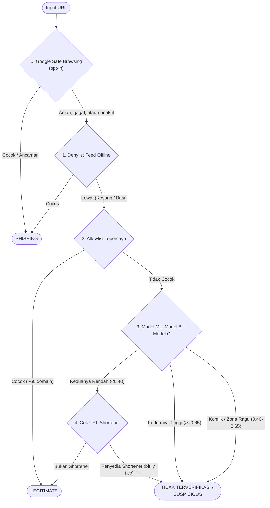

# PhishGuard — Deteksi Phishing Berlapis dari URL

[](https://www.python.org)
[](https://fastapi.tiangolo.com)
[](https://reflex.dev)
[](#pengujian)
[](https://creativecommons.org/licenses/by-nc-sa/4.0/)

PhishGuard mengklasifikasikan URL sebagai **phishing**, **legitimate**, atau **TIDAK TERVERIFIKASI** (pada API: `SUSPICIOUS`) menggunakan model machine learning berbasis dataset [PhiUSIIL](https://www.kaggle.com/datasets/ndarvind/phiusiil-phishing-url-dataset). Setiap keputusan dijelaskan secara transparan melalui jejak evaluasi (`trail`) yang merinci lapisan mana yang memicu vonis dan alasan logisnya. Antarmuka aplikasi dibangun dengan **Reflex** (100% Python) dan inferensi berkecepatan tinggi dilayani oleh **FastAPI**.

Proyek ini dikembangkan dalam lingkup mata kuliah **Keamanan Informasi** (KP70065004), Program Studi Informatika, Universitas Siliwangi.

> [!NOTE]
> **Prinsip Kejujuran Deteksi:** Fokus utama proyek bukan sekadar mengejar skor tinggi pada test set sintetik/akademik, melainkan menghadirkan deteksi yang jujur: menampilkan limitasi, memisahkan metrik test set dari uji dunia nyata, dan menguraikan batasan teknis di setiap lapisan pertahanan.

---

## Arsitektur Deteksi Berlapis

Setiap permintaan inferensi URL dievaluasi secara bertahap dan berhenti seketika di lapisan pertama yang mencapai vonis pasti:



### Rincian Peran Lapisan & Model
0. **Lapisan 0 — Google Safe Browsing (Opsional, Fail-safe):** Validasi eksternal tertinggi. Aktif hanya bila `PHISHGUARD_USE_GOOGLE=true` dan `PHISHGUARD_GOOGLE_API_KEY` diisi. Bila Google menandai `MALWARE`/`SOCIAL_ENGINEERING`, sistem langsung `PHISHING` (`decision_source="google_safe_browsing"`). Timeout 5 detik; error/timeout apa pun dianggap "tidak ada match" dan inference lanjut ke lapisan offline. Default **mati** (`false`).
1. **Lapisan 1 — Denylist Feed Lokal (Offline):** Pencocokan cepat dengan snapshot feed phishing publik (OpenPhish). Jika file snapshot tidak ada atau telah berusia lebih dari 24 jam (`PHISHGUARD_FEED_MAX_AGE_HOURS`), lapisan dilewati dengan aman dan dicatat di `trail`.
2. **Lapisan 2 — Allowlist Domain Tepercaya (Offline):** Pencocokan string domain terhadap ~60 domain korporat/populer (`src/trusted_domains.json`) untuk mencegah false positive pada layanan esensial.
3. **Lapisan 3 — Ensemble Model ML:**
   - **Model B** (`src/model.pkl`): XGBoost dengan 19 fitur leksikal URL murni (dihitung langsung dari string URL via `extract_features()`).
   - **Model C** (`models/experimental/C_host.pkl`): 10 fitur host/domain. Model C bersifat modular; jika file model tidak ada, sistem otomatis beralih menggunakan zona probabilitas Model B saja.
   - **Model A** (`src/model_full.pkl`, Random Forest 50 fitur termasuk konten halaman HTML/DOM): Hanya digunakan sebagai baseline laporan holdout dataset dan **tidak dijalankan** pada inferensi langsung guna menghindari train/serve skew dan latensi jaringan.
4. **Lapisan 4 — Deteksi Pemendek Tautan (Shortener):** URL yang lolos sebagai legitimate tetapi menggunakan domain pemendek URL (seperti `bit.ly`, `t.co`) dialihkan statusnya menjadi `TIDAK TERVERIFIKASI` karena tujuan akhir tautan disembunyikan.

> [!IMPORTANT]
> **Klausul Inferensi Offline & Etika:** Secara default, ekstraksi fitur dan penentuan vonis murni manipulasi string: sistem tidak membuka soket, melakukan resolusi DNS, HTTP fetch, atau probing aktif ke URL target. Pengecualian opt-in adalah Lapisan 0: bila diaktifkan, URL yang diperiksa dikirim ke Google Safe Browsing (bukan dibuka/diprobe). Tanpa konfigurasi, sistem tetap 100% offline. Data feed denylist tidak didistribusikan ulang.

### Mengaktifkan Layer 0 (opsional)
```env
# di .env (jangan commit nilai asli)
PHISHGUARD_USE_GOOGLE=true
PHISHGUARD_GOOGLE_API_KEY=isi-kunci-anda
```

Verifikasi cepat setelah API berjalan:

```powershell
curl.exe -X POST http://localhost:8001/check -H "Content-Type: application/json" -d '{"url":"http://testsafebrowsing.appspot.com/s/phishing.html"}'
```

Respons memuat `"decision_source": "google_safe_browsing"`. Dengan `PHISHGUARD_USE_GOOGLE=false`, URL yang sama diproses lapisan offline dan tetap mengembalikan JSON tanpa error.

---

## Hasil Evaluasi & Benchmark

### 1. Metrik Holdout Test Set (Dataset PhiUSIIL)
Diuji pada 47.159 baris data holdout independen yang tidak pernah dilihat selama pelatihan (sumber: `docs/hasil_evaluasi.md`):

| Model | Fitur | Accuracy | Precision (Phishing) | Recall (Phishing) | F1-Score (Phishing) | False Positive (FP) | False Negative (FN) |
|---|---|---|---|---|---|---|---|
| **Model B — URL Leksikal (XGBoost)** | 19 | **0.9968** | **0.9986** | **0.9940** | **0.9963** | 28 | 122 |
| **Model A — Full HTML/DOM (Random Forest)** | 50 | 1.0000 | 1.0000 | 1.0000 | 1.0000 | 0 | 0 |

### 2. Realita Evaluasi Dunia Nyata
Hasil uji pada feed phishing dunia nyata dan URL modern jauh lebih menantang dibandingkan dataset akademik tertutup. Semua metrik empiris dibaca secara transparan dari file JSON hasil eksperimen:
- `docs/realworld.json` — Evaluasi terhadap URL live non-PhiUSIIL (lihat [Panduan Real-world](docs/realworld_README.md)).
- `docs/t25.json` — Eksperimen model C berbasis host (lihat [Analisis Model C](docs/model_c.md)).
- `docs/denylist.json` — Evaluasi cakupan snapshot denylist OpenPhish (lihat [Panduan Denylist](docs/denylist_README.md)).

> [!WARNING]
> Contoh domain FP/FN di `docs/hasil_evaluasi.md` merupakan label mentah dataset PhiUSIIL dan belum diverifikasi secara independen; jangan menyebut domain publik sebagai phishing tanpa menyertakan konteks keterbatasan dataset.

---

## Panduan Instalasi & Menjalankan

### Prasyarat
- **Python 3.11**
- Paket manager **[`uv`](https://docs.astral.sh/uv/)**

### 1. Lingkungan Windows (PowerShell)

```powershell
# Clone repositori
git clone https://github.com/Raka-coder/phishguard-rfxgb.git
cd phishguard-rfxgb

# Pasang uv (jika belum terpasang) dan sinkronisasi virtual environment
powershell -c "irm https://astral.sh/uv/install.ps1 | iex"
uv sync

# Unduh dan siapkan dataset (idempotent, opsional jika hanya menjalankan aplikasi)
uv run python scripts/download_data.py
uv run python scripts/convert_parquet.py
uv run python scripts/inspect_data.py   # Wajib memverifikasi: 235795 baris; label 1: 134850, 0: 100945

# Opsional: Unduh snapshot feed phishing untuk lapisan denylist
uv run python scripts/sync_feeds.py

# Verifikasi test suite dan kompilasi antarmuka
uv run pytest -q                        # 182 tests
uv run reflex compile

# Terminal 1 — Jalankan FastAPI Service
uv run uvicorn api.main:app --port 8001

# Terminal 2 — Jalankan Antarmuka Reflex (Frontend :3000, Backend :8000)
$env:CI=1; uv run reflex run
```

> [!TIP]
> Jika frontend Reflex di Windows gagal dijalankan karena dependensi DLL Bun/Node, pasang **Microsoft Visual C++ 2015-2022 Redistributable (x64)**.

---

### 2. Lingkungan Linux / macOS

```bash
git clone https://github.com/Raka-coder/phishguard-rfxgb.git
cd phishguard-rfxgb

curl -LsSf https://astral.sh/uv/install.sh | sh
uv sync

uv run python scripts/download_data.py
uv run python scripts/convert_parquet.py
uv run python scripts/inspect_data.py

uv run python scripts/sync_feeds.py
uv run pytest -q
uv run reflex compile

# Terminal 1: API
uv run uvicorn api.main:app --port 8001

# Terminal 2: UI Reflex
CI=1 uv run reflex run
```

---

### 3. Opsi Container (Docker / Podman, satu perintah)

Lihat [docs/DOCKER.md](docs/DOCKER.md). Ringkasnya:

```bash
./run.sh up   # build + start (detached); run pertama unduh dataset + training
```

UI: http://localhost:3000 — API: http://localhost:8001. Run berikutnya langsung
siap (artefak ada di volume `phishguard-data`). `./run.sh reset` untuk paksa
training ulang.

---

## Artefak & Integritas Model

Artefak model operasional berikut telah disertakan langsung di repositori sehingga tidak mewajibkan pelatihan ulang:

| File | Ukuran | Deskripsi & Peran |
|---|---|---|
| `src/model.pkl` | ~880 KB | Model B utama (XGBoost 19 fitur leksikal) |
| `src/tld_probs.json` | ~4 KB | Tabel probabilitas legitimate per TLD untuk Model B |
| `models/experimental/C_host.pkl` | ~1.2 MB | Model C eksperimental (10 fitur berbasis host) |
| `models/experimental/tld_probs_host.json` | ~4 KB | Tabel probabilitas TLD khusus Model C |

### Verifikasi Checksum SHA256
```text
9e7293bddfc3cb79a4fde0c7aa445aa759e2ab8556c61902231051c3dc0e280b  src/model.pkl
60faa4123b57a44aaacf20b3eeb21bf2159cdc81afc2c4653e1f9ac830e8a231  models/experimental/C_host.pkl
00a6de620719b2dc0833f3acff39a88f8effa3da5856da233b5bc88cb526bd39  models/experimental/tld_probs_host.json
5087b2324f6a4cc4e082c33987b0558efbf00506c9b554557b759ddfe2f521ee  src/tld_probs.json
```

> [!CAUTION]
> Serialisasi Pickle/Joblib dapat mengeksekusi kode sembarang saat dimuat. Muat hanya artefak yang terverifikasi dari repositori terpercaya.

Artefak yang sengaja diabaikan dari git (`.gitignore`):
- `data/PhiUSIIL.csv` & `data/PhiUSIIL.parquet` (lisensi dataset CC BY-NC-SA 4.0).
- `src/model_full.pkl` (Model A evaluasi; dibuat dengan `uv run python src/train.py`).
- `data/feeds/*.txt` (snapshot unduhan OpenPhish).

---

## Konfigurasi Lingkungan (`.env`)

Konfigurasi aplikasi dapat disesuaikan melalui file `.env` (dapat disalin dari `.env.example`):

```bash
# Windows
copy .env.example .env
# Linux / macOS
cp .env.example .env
```

| Variabel | Nilai Default | Keterangan |
|---|---|---|
| `PHISHGUARD_API_URL` | `http://localhost:8001/check` | Endpoint API yang dipanggil oleh antarmuka Reflex |
| `PHISHGUARD_FEED_DIR` | `data/feeds` | Direktori penyimpanan snapshot feed OpenPhish |
| `PHISHGUARD_FEED_MAX_AGE_HOURS` | `24` | Batas kedaluwarsa feed denylist sebelum dilewati |

---

## Penggunaan API

### `POST /check`
Menganalisis URL dan mengembalikan vonis klasifikasi, probabilitas, jejak keputusan per lapisan, serta fitur yang paling berpengaruh.

**Permintaan (cURL):**
```bash
curl -X POST http://localhost:8001/check \
  -H "Content-Type: application/json" \
  -d '{"url": "https://secure-login.bank-verify.fake-domain.xyz/auth"}'
```

**Respons (JSON):**
```json
{
  "url": "https://secure-login.bank-verify.fake-domain.xyz/auth",
  "verdict": "PHISHING",
  "risk_level": "TINGGI",
  "probability": 0.9842,
  "label": 0,
  "decision_source": "model",
  "reason": "Probabilitas phishing dari fitur URL tinggi (0.9842)",
  "trail": [
    {"layer": "denylist", "result": "PASS", "detail": "Tidak cocok dengan denylist lokal"},
    {"layer": "allowlist", "result": "PASS", "detail": "Bukan domain terdaftar allowlist"},
    {"layer": "model", "result": "HIT", "detail": "Model XGBoost mendeteksi pola leksikal mencurigakan"}
  ],
  "top_features": [
    {"feature": "SpacialCharRatioInURL", "value": 0.12, "impact": "phishing"},
    {"feature": "TLDLegitimateProb", "value": 0.04, "impact": "phishing"}
  ],
  "inference_ms": 1.25
}
```

### `GET /health`
Mengecek status kesiapan service dan ketersediaan artefak model di memori.

---

## Pengujian & Verifikasi

Semua perintah pengujian dijalankan dari root repositori menggunakan environment `uv`:

```powershell
# Menjalankan seluruh test suite otomatis (182 tests)
uv run pytest -q

# Menjalankan satu test spesifik
uv run pytest -q tests/test_predict.py::test_predict_url_allowlist

# Menguji kompilasi antarmuka Reflex
uv run reflex compile

# Uji korpus contoh URL sintetis
uv run python scripts/test_live_urls.py
uv run python scripts/test_live_urls.py --markdown

# Evaluasi isolasi & kumulatif tiap lapisan -> docs/layer_tests.json
uv run python scripts/test_layers.py
```

### Pengujian lapisan (L0–L4)

`scripts/test_layers.py` menjalankan setiap lapisan sendirian lalu bertingkat
(L1 → L1+L2 → … → L0+L1..L4) pada set dunia nyata, menghitung deteksi phishing,
false positive pada legit, dan waktu rata-rata, lalu menulis semuanya ke
`docs/layer_tests.json`. Tidak ada angka yang diketik manual di dokumen.

- **Guard anti-melingkar:** run dibatalkan bila lebih dari 5% URL set uji ada di
  snapshot feed yang dipakai. Snapshot historis dipakai dengan `--max-age-hours 168`.
- **L0 hanya mock:** tidak ada kebenaran Google Safe Browsing offline, jadi
  angkanya adalah skenario batas atas, bukan akurasi.
- **Celah yang diketahui:** lapisan peniruan merek (T20) belum ada; model tidak
  pernah memvonis `PHISHING` (hanya denylist/GSB), sehingga `SUSPICIOUS`
  dilaporkan terpisah.

---

## Struktur Direktori

```text
phishguard-rfxgb/
├── api/                    # Layanan FastAPI :8001 (/check, /health)
├── app/                    # Web UI Reflex :3000 & State management
│   ├── pages/              # Halaman antarmuka (index, evaluasi)
│   ├── app_state.py        # Pengelola state reaktif Reflex
│   └── style.py            # Desain tema, warna, dan komponen visual
├── assets/                 # Aset grafis statis dan styling
├── data/                   # Dataset PhiUSIIL & snapshot feed (gitignored)
├── docs/                   # Spesifikasi teknis, PRD v1/v2, skema, dan catatan analisis
├── models/experimental/    # Model eksperimental C_host.pkl & tld_probs_host.json
├── scripts/                # Script otomasi data, evaluasi, training, dan feed sync
├── src/                    # Modul inti (predict, config, feature_utils, denylist, reputation, google_sb)
└── tests/                  # Unit tests & integrasi (182 tests) + fixtures sintetis
```

---

## Konvensi Arsitektur & Rekayasa

- **Inversi Label Dataset:** `1 = legitimate`, `0 = phishing`. Di seluruh metrik dan kode, $P(\text{phishing}) = \text{predict\_proba}[:, 0]$ dengan `pos_label=0`.
- **Reproducibility Split:** Pembagian data wajib menggunakan fungsi `src/config.py:make_split(df)` (Stratified, seed 42) untuk memastikan holdout test set (47.159 baris) steril dari data latih.
- **Pencegahan Kebocoran (Data Leakage):** Fitur konten HTML/DOM (`LineOfCode`, `Bank`, `HasTitle`, dll.) hanya diizinkan untuk Model A. Model B dilatih secara murni dari hasil recomputasi leksikal URL `feature_utils.to_frame()`.
- **Offline by Default:** `predict_url()` tidak melakukan request jaringan atau resolusi DNS eksternal, kecuali Lapisan 0 Google Safe Browsing yang diaktifkan eksplisit (`PHISHGUARD_USE_GOOGLE=true` + API key). Lapisan 0 fail-safe: timeout/error diperlakukan sebagai "tidak ada match".
- **Port Layanan:** FastAPI di port `:8001`, Reflex backend di `:8000`, Reflex frontend di `:3000`.

---

## Referensi & Bacaan Lanjutan

1. **Prasad, A., & Chandra, S. (2023).** *PhiUSIIL: A diverse security profile empowered phishing URL detection framework.* Computers & Security, 131, 103545. [https://doi.org/10.1016/j.cose.2023.103545](https://doi.org/10.1016/j.cose.2023.103545).
2. **Kaggle Dataset:** [ndarvind/phiusiil-phishing-url-dataset](https://www.kaggle.com/datasets/ndarvind/phiusiil-phishing-url-dataset) (Lisensi: CC BY-NC-SA 4.0).
3. **OpenPhish:** Public Feed Data Phishing [https://openphish.com](https://openphish.com).
4. **Dokumentasi Internal Proyek:**
   - [Product Requirement Document (PRD v1)](docs/phishguard-prd.md)
   - [Product Requirement Document v2 (PRD v2)](docs/PRD-v2.md)
   - [Arsitektur Sistem Berlapis](docs/phishguard-architecture.md)
   - [Spesifikasi Kontrak & Skema Data](docs/phishguard-schema.md)
   - [Laporan Evaluasi & Batasan Model](docs/hasil_evaluasi.md)
   - [Dokumentasi Model C Host](docs/model_c.md)
   - [Dokumentasi Evaluasi Denylist Offline](docs/denylist_README.md)
   - [Dokumentasi Set Uji Dunia Nyata](docs/realworld_README.md)
