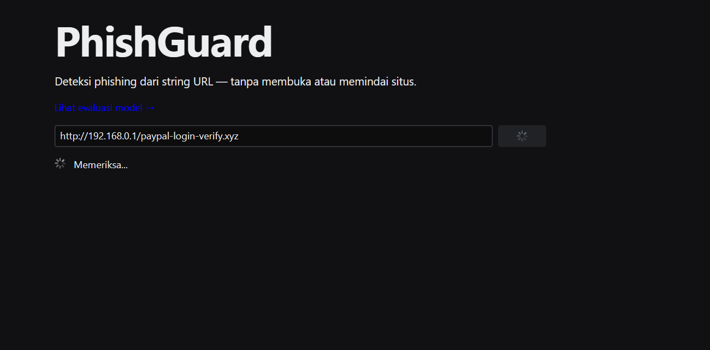
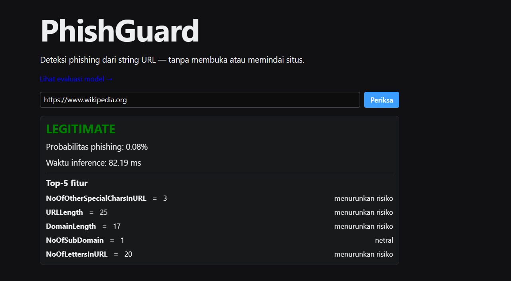
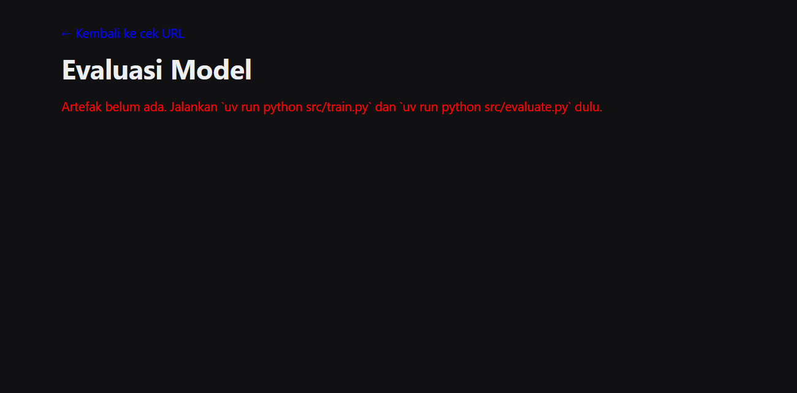

# PhishGuard — Deteksi Phishing Berbasis URL

[](https://www.python.org)
[](https://fastapi.tiangolo.com)
[](https://reflex.dev)
[](#testing)
[](https://creativecommons.org/licenses/by-nc-sa/4.0/)

Klasifikasi biner URL (**phishing vs legitimate**) memakai **Random Forest** dan **XGBoost** pada dataset
[PhiUSIIL](https://www.kaggle.com/datasets/ndarvind/phiusiil-phishing-url-dataset), dengan antarmuka web
**Reflex** (100% Python) dan **FastAPI** untuk inference. Proyek mata kuliah Keamanan Informasi — KP70065004,
Informatika, Universitas Siliwangi.

> Spesifikasi lengkap ada di `docs/`: [PRD](docs/phishguard-prd.md) · [arsitektur](docs/phishguard-architecture.md) · [skema & kontrak](docs/phishguard-schema.md) · [rencana implementasi T1–T12](docs/phishguard-implementation.md).

## Highlights

- **Dua model by design:** Model A (50 fitur, termasuk konten halaman) untuk laporan; Model B (19 fitur leksikal URL) yang dipakai API & UI.
- **Tanpa jaringan saat inference:** `extract_features()` murni string → dict, tidak fetch/resolve/probe URL.
- **Arah label eksplisit:** PhiUSIIL `1 = legitimate`, `0 = phishing`, sehingga `P(phishing) = predict_proba[:, 0]`.
- **Split tunggal:** `config.make_split(df)` (stratified, seed 42) dipakai `train.py` dan `evaluate.py` — test set 47.159 baris tidak pernah dilatih.
- **UI 100% Python** (Reflex 0.11): halaman cek URL dan halaman evaluasi, tanpa JS/HTML manual.

## Keputusan berlapis (T14)

`predict_url` kini mengembalikan keputusan user-facing `verdict` selain `label` biner:

1. **Allowlist domain tepercaya (offline)** → `LEGITIMATE`, `decision_source="allowlist"`, `probability=null`.
2. **Model XGBoost** → `P(phishing)`:
   - `P >= 0.65` → `PHISHING` (`model`)
   - `0.40 <= P < 0.65` → `SUSPICIOUS` (`uncertainty`, perlu verifikasi manual)
   - `P < 0.40` → `LEGITIMATE` (`model`)

`label` (0/1) tetap mengikuti `THRESHOLD=0.5` agar kompatibel dengan metrik/test lama.
Tanpa network at inference; lapisan PhishTank/Whois/DNS ditunda (future work).

## Hasil

| Model | Fitur | Test accuracy | Precision (phishing) | Recall (phishing) | F1 (phishing) | FP | FN |
|---|---|---|---|---|---|---|---|
| **B — URL-only (xgb)** | 19 | 0.9968 | 0.9986 | 0.9940 | 0.9963 | 28 | 122 |
| A — full (rf) | 50 | 1.0000 | 1.0000 | 1.0000 | 1.0000 | 0 | 0 |

CV (5-fold, train): Model A RF 1.0000 · Model B XGB 0.9962. Laporan lengkap: [`docs/hasil_evaluasi.md`](docs/hasil_evaluasi.md).

## Quick start

```powershell
git clone https://github.com/Raka-coder/phishguard-rfxgb.git
cd phishguard-rfxgb
uv sync
uv run python scripts/download_data.py      # unduh dataset (~150 MB, butuh internet; idempotent)
uv run python scripts/convert_parquet.py   # sekali per laptop -> data/PhiUSIIL.parquet (15 MB)
uv run python scripts/inspect_data.py      # verifikasi: 235795 baris; label 1: 134850, 0: 100945

uv run python src/train.py                  # latih model
uv run python src/evaluate.py               # metrik + FP/FN

uv run uvicorn api.main:app --port 8001     # terminal 1 - API
uv run reflex run                           # terminal 2 - web di http://localhost:3000
```

> **Verifikasi wajib:** angka output `inspect_data.py` harus persis `235795 baris; label 1: 134850, 0: 100945`
> di semua laptop. Kalau berbeda, STOP dan laporkan.

> Semua perintah Python **wajib** lewat `uv run`. Jangan pakai `python`/`pip` global.

### Troubleshooting

- **`model.pkl` / `tld_probs.json` / isi `data/` tidak terlihat di IDE atau GitHub — itu NORMAL.**
  File-file ini di-gitignore dan dibuat ulang lokal (`uv run python src/train.py`).
  Cek dengan `git status --ignored`.
- **Download gagal (offline/timeout):** fallback manual —
  1. Buka https://www.kaggle.com/datasets/ndarvind/phiusiil-phishing-url-dataset
  2. Download ZIP, ekstrak, rename hasilnya menjadi `data/PhiUSIIL.csv`
  3. Jalankan ulang `uv run python scripts/download_data.py` (akan terdeteksi "sudah ada" dan skip).

## Prasyarat

| Kebutuhan | Cek |
|---|---|
| Windows 10/11 + Python 3.11 | `uv --version` (uv mengunduh Python 3.11 otomatis) |
| [uv](https://docs.astral.sh/uv/) | `powershell -c "irm https://astral.sh/uv/install.ps1 \| iex"` |
| Git | `git --version` |
| Dataset CSV dari Kaggle | `data/PhiUSIIL.csv` |

Bila frontend Reflex gagal start dengan error DLL/bun di Windows, pasang Microsoft Visual C++ 2015 Redistributable x64.

## Menjalankan aplikasi

```powershell
uv run python src/train.py                   # latih model
uv run python src/evaluate.py                # metrik + FP/FN
uv run uvicorn api.main:app --port 8001      # terminal 1 — API
uv run reflex run                            # terminal 2 — web di http://localhost:3000
```

API: `POST /check` (body `{"url": "..."}`), `GET /health`. Port `:8001` (API), `:8000` (Reflex backend), `:3000` (frontend).

## Testing

```powershell
uv run pytest -q                             # 43 tests
uv run pytest -q tests/test_predict.py::test_nama
uv run reflex compile                        # cek UI tanpa server
```

## Struktur proyek

```
docs/                 spesifikasi + hasil evaluasi (metrics.json, stats.json, hasil_evaluasi.md)
data/                 PhiUSIIL.csv (54 MB, Kaggle), PhiUSIIL.parquet (15 MB) — gitignored
scripts/              inspect_data.py, convert_parquet.py, test_live_urls.py
src/                  config.py, feature_utils.py, train.py, evaluate.py, predict.py
api/                  main.py (FastAPI :8001)
app/                  app.py, app_state.py, pages/ (index, evaluasi), style.py
tests/                test_*.py + fixtures/urls.txt
docs/screenshots/     screenshot UI
```

## Konvensi penting

- **Arah label terbalik:** `1 = legitimate`, `0 = phishing`. `P(phishing) = predict_proba[:, 0]`.
- **Split hanya dari `src/config.py: make_split(df)`** (stratified, seed 42). Jangan buat split sendiri.
- **Dua model:** Model A hanya untuk laporan; Model B yang dipakai API & UI. Fitur konten di Model B = kebocoran data.
- **Model B dihitung ulang** dari string URL via `extract_features()` saat training.
- **Port:** API `:8001`, backend Reflex `:8000`, frontend `:3000`.
- **Tanpa akses jaringan saat inference.**
- **Reflex 0.11:** halaman didaftarkan eksplisit dengan `app.add_page(...)`; kontrol alur memakai `rx.cond`/`rx.foreach`.

## Dataset & Atribusi

- **Sumber:** Prasad & Chandra (2023), *PhiUSIIL: A diverse security profile empowered phishing URL detection framework*, Computers & Security, doi:[10.1016/j.cose.2023.103545](https://doi.org/10.1016/j.cose.2023.103545).
- **Distribusi:** Kaggle — [ndarvind/phiusiil-phishing-url-dataset](https://www.kaggle.com/datasets/ndarvind/phiusiil-phishing-url-dataset).
- **Lisensi:** CC BY-NC-SA 4.0 — non-komersial, dengan atribusi, turunan dibagikan dengan lisensi yang sama.
- Dataset (`data/PhiUSIIL.csv`, `data/PhiUSIIL.parquet`) **tidak di-commit** (`.gitignore`).

## Screenshot








## Checklist Kriteria Sukses (PRD §9)

- [x] 1. `inspect_data.py`: 235.795 baris; label `1: 134.850`, `0: 100.945`.
- [x] 2. `train.py` menghasilkan `model.pkl` + `model_full.pkl` + `metrics.json`.
- [x] 3. `evaluate.py` menulis precision/recall/F1 + confusion matrix + FP/FN ke `hasil_evaluasi.md`.
- [x] 4. `CI=1 uv run reflex run` jalan bersih; halaman utama & evaluasi tampil.
- [x] 5. `POST /check` → 200 (valid) / 400 (invalid).
- [x] 6. ≥3 contoh FP dan ≥3 FN nyata terdokumentasi (28 FP + 122 FN).
- [ ] 7. Video demo 5–10 menit (4 babak) — tugas owner.

## Peta jalan

T1 scaffolding ✅ · T2 `inspect_data.py` ✅ · T3 `convert_parquet.py` ✅ · T4 `config.py` + `feature_utils.py` ✅ ·
T5 `train.py` ✅ · T6 `evaluate.py` ✅ · T7 `predict.py` + test ✅ · T8 API ✅ · T9 UI index ✅ · T10 halaman evaluasi ✅ ·
T11 uji URL live ✅ · T12 poles & dokumentasi ✅ (tag `v1.0` menunggu URL PhishTank verified).

## Etika

Proyek ini hanya menganalisis string URL dan tidak melakukan pemindaian atau serangan ke pihak ketiga.
Dataset dipakai untuk keperluan akademik non-komersial dengan atribusi (CC BY-NC-SA 4.0).

## Referensi

- Prasad & Chandra (2023), *PhiUSIIL: A diverse security profile empowered phishing URL detection framework*, Computers & Security, doi:[10.1016/j.cose.2023.103545](https://doi.org/10.1016/j.cose.2023.103545).
- Spesifikasi: [PRD](docs/phishguard-prd.md) · [arsitektur](docs/phishguard-architecture.md) · [skema & kontrak](docs/phishguard-schema.md) · [rencana implementasi](docs/phishguard-implementation.md).
