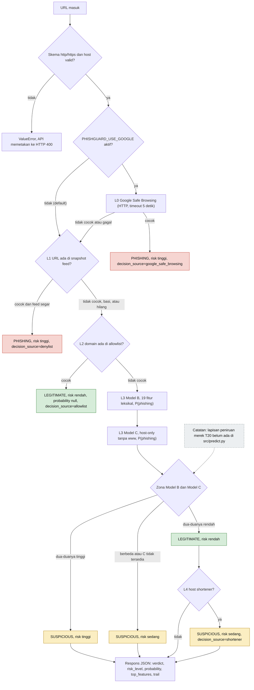
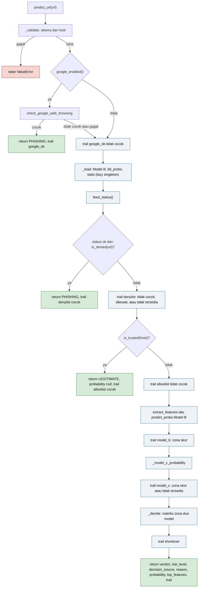
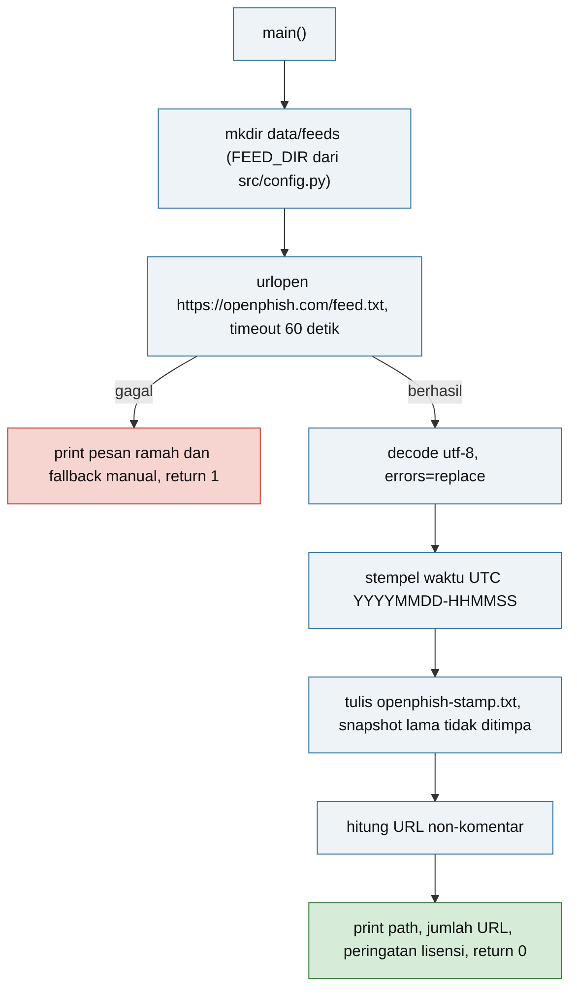

# Diagram Mermaid (T32)

Berkas `.mmd` di folder ini adalah sumber diagram untuk Bab 3. Setiap diagram disalin
sebagai blok kode di bawah agar bisa langsung ditempel ke `results/laporan/bab3.md`.
Renderer yang dipakai: Mermaid bawaan GitHub, atau `mmdc` dari `@mermaid-js/mermaid-cli`.
Bila `src/predict.py` berubah, perbarui `.mmd` dan blok di bawah pada saat yang sama.

Isi diagram mengikuti penomoran lapisan yang benar-benar ada di `src/predict.py`:
L0 Google Safe Browsing (opt-in), L1 denylist feed, L2 allowlist, L3 Model B + Model C,
L4 shortener. Lapisan peniruan merek (T20) belum diimplementasikan, sehingga tidak
digambar sebagai lapisan.

## 1. Alur keputusan berlapis (`alur_keputusan.mmd`)

## 2. Flowchart `predict_url` dengan short-circuit (`predict_url.mmd`)

## 3. Flowchart `sync_feeds.py` (`sync_feeds.mmd`)

Catatan sinkronisasi feed: `sync_feeds.py` adalah satu-satunya skrip yang membuka
jaringan secara rutin. Inferensi `predict_url` tetap offline kecuali L0 diaktifkan
lewat `PHISHGUARD_USE_GOOGLE=true`.
