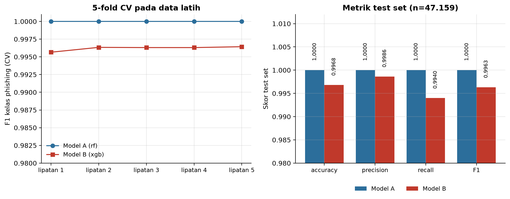
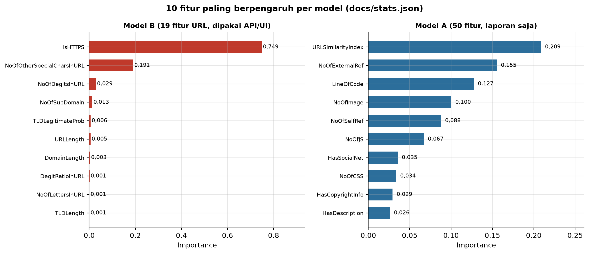
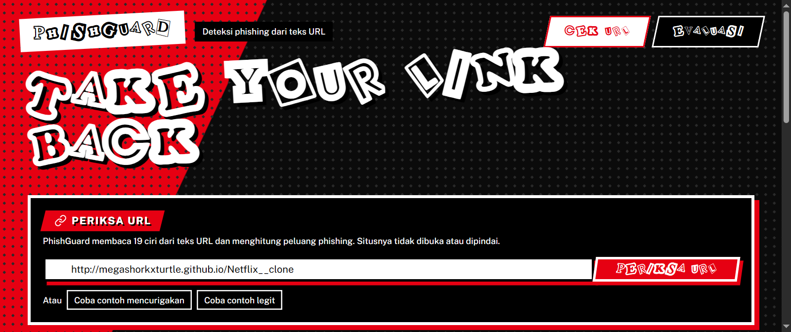
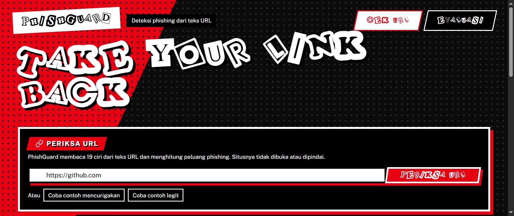
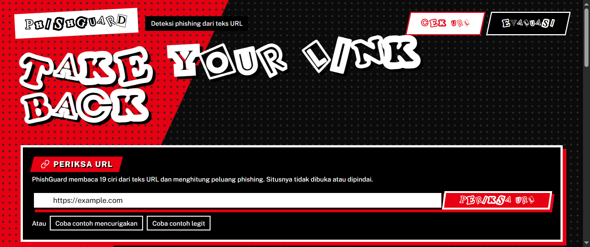

# Bab 3 — Perancangan dan Implementasi Sistem

Bab ini menjelaskan perancangan PhishGuard: arsitektur berlapis, pengolahan data,
logika prediksi, dan antarmuka web. Setiap angka pada tabel dan gambar di bab ini
dirujuk ke berkas JSON atau dokumen yang tercantum di kapsi, sehingga pembaca dapat
menelusuri ulang ke sumbernya.

## 3A Arsitektur sistem

### 3A.1 Lapisan dan pembagian tanggung jawab

PhishGuard dibangun sebagai tumpukan empat lapisan Python yang berjalan lokal di
laptop pengguna. Lapisan teratas adalah antarmuka web Reflex, lapisan kedua adalah
API FastAPI, lapisan ketiga adalah modul inferensi dan model, dan lapisan terbawah
adalah data offline. Pemisahan ini sengaja dibuat agar model tidak mengetahui
apa pun tentang web, API dapat diuji mandiri dengan `curl`, dan antarmuka tidak
pernah menyentuh dataset.


**Gambar 3.1** Alur keputusan berlapis sesuai penomoran aktual di `src/predict.py`.
Lapisan peniruan merek (T20) belum diimplementasikan, sehingga tidak digambar
sebagai lapisan. Sumber diagram: `results/diagrams/alur_keputusan.mmd`.

Diagram Mermaid di atas ditempel apa adanya dari berkas `.mmd` di
`results/diagrams/`. Renderer yang cocok: Mermaid bawaan GitHub atau `mmdc`.

### 3A.2 Alur inference dengan short-circuit

Setiap panggilan `predict_url(url)` mengembalikan keputusan dari lapisan pertama
yang memutuskan. Lapisan berikutnya tidak dievaluasi. Urutan dan hasil yang
mungkin adalah:

1. Google Safe Browsing (opsional, default mati) mengembalikan `PHISHING` jika
   URL cocok.
2. Denylist feed mengembalikan `PHISHING` jika URL ada di snapshot feed lokal.
3. Allowlist domain tepercaya mengembalikan `LEGITIMATE` dengan `probability`
   kosong.
4. Model B dan Model C menghitung skor phishing; vonis berasal dari matriks zona
   kedua skor.
5. Shortener menaikkan `LEGITIMATE` menjadi `SUSPICIOUS` jika host adalah layanan
   pemendek URL.


**Gambar 3.2** Flowchart `predict_url` dengan short-circuit. Sumber:
`results/diagrams/predict_url.mmd`.

### 3A.3 Dua model by design

PhishGuard memakai dua model dengan peran berbeda. Model A (`src/model_full.pkl`)
memakai 50 fitur numerik PhiUSIIL, termasuk fitur konten halaman, dan dipakai
untuk evaluasi serta laporan. Model B (`src/model.pkl`) memakai 19 fitur leksikal
yang dapat dihitung dari string URL dan dipakai di API serta antarmuka. Perbedaan
ini bukan optimasi kecil: fitur konten tidak tersedia saat inference live, sehingga
menyajikan satu model saja akan menimbulkan leakage (R2 di PRD).



**Gambar 3.3** Selisih F1 test set Model A dan Model B hanya 0,0037, padahal
Model A memakai 50 fitur termasuk fitur konten halaman yang tidak tersedia saat
inferensi. n = 47.159 URL test set; CV 5 lipatan pada 188.636 baris latih.
Sumber: `docs/metrics.json`, `docs/hasil_evaluasi.md`.

Tabel 3.1 merangkum perbedaan kedua model.

| Aspek | Model A (full) | Model B (url, produksi) |
|---|---|---|
| Artefak | `src/model_full.pkl` | `src/model.pkl` |
| Jumlah fitur | 50 | 19 |
| Input | Baris dataset lengkap | String URL bebas |
| Fitur konten halaman | Ya | Tidak |
| Ketersediaan saat live | Banyak tidak bisa dihitung | Semua bisa dihitung |
| Peran | Evaluasi dan laporan | API dan Reflex |
| Algoritma terbaik | Random Forest | XGBoost |
| F1 test set (phishing) | 1,0000 | 0,9963 |

Sumber: `docs/metrics.json`, `docs/stats.json`.

### 3A.4 Keputusan arsitektural

Keputusan utama yang memengaruhi bab-bab berikutnya adalah:

- FastAPI wajib di port 8001, port 8000 milik backend Reflex (R6).
- Data tidak di-commit karena ukuran dan lisensi CC BY-NC-SA 4.0; tiap anggota
  membangun data lokal.
- Tidak ada LLM; klasifikasi memakai Random Forest dan XGBoost klasik.
- Predict memakai singleton preload agar latensi di bawah 200 ms.

## 3B Pengolahan data

### 3B.1 Sumber data dan label

Data latih berasal dari PhiUSIIL Phishing URL Dataset (Kaggle,
`ndarvind/phiusiil-phishing-url-dataset`), disimpan lokal sebagai
`data/PhiUSIIL.csv` lalu dikonversi ke `data/PhiUSIIL.parquet`. Dataset berisi
235.795 baris dan 55 kolom: 54 fitur ditambah kolom label. Distribusi label
adalah 134.850 legitimate (label 1) dan 100.945 phishing (label 0). Arah label
ini terbalik dari intuisi, sehingga seluruh evaluasi memakai
`P(phishing) = predict_proba[:, 0]`.

### 3B.2 Dua proyeksi fitur (anti-leakage)

Satu sumber kolom `URL` dan dataset menghasilkan dua proyeksi fitur yang berbeda.
Proyeksi A (full) memakai 50 kolom numerik dataset untuk Model A. Proyeksi B
(URL-only, 19 fitur) dihitung ulang dari string URL oleh
`feature_utils.extract_features()` saat training, bukan disalin dari kolom
dataset. Alasan teknisnya adalah beberapa kolom dataset, misalnya
`NoOfLettersInURL` dan `CharContinuationRate`, tidak dapat direproduksi dari
string URL sehingga menyalinnya menimbulkan train/serve skew.

Daftar 19 fitur Model B adalah:

| No | Fitur | No | Fitur |
|---|---|---|---|
| 1 | URLLength | 11 | NoOfEqualsInURL |
| 2 | DomainLength | 12 | NoOfQMarkInURL |
| 3 | TLDLength | 13 | NoOfAmpersandInURL |
| 4 | NoOfSubDomain | 14 | NoOfOtherSpecialCharsInURL |
| 5 | IsDomainIP | 15 | SpacialCharRatioInURL |
| 6 | IsHTTPS | 16 | HasObfuscation |
| 7 | NoOfLettersInURL | 17 | NoOfObfuscatedChar |
| 8 | LetterRatioInURL | 18 | ObfuscationRatio |
| 9 | NoOfDegitsInURL | 19 | TLDLegitimateProb |
| 10 | DegitRatioInURL | | |

Sumber: `src/config.py` (`URL_FEATURES`).

`TLDLegitimateProb` dihitung dari lookup TLD yang dibangun saat training
(`src/tld_probs.json`) dengan rumus `(jumlah legit per TLD + 1) / (jumlah total per TLD + 2)`,
default 0,5719 pada 12.597 TLD. Fitur `URLSimilarityIndex`, `URLCharProb`,
`CharContinuationRate`, dan `IsUnresolvableHost` sengaja tidak masuk Model B
karena membutuhkan statistik korpus atau DNS.

### 3B.3 Split dan reproduksibilitas

Split stratified 80/20 dengan seed 42 menghasilkan 188.636 baris latih dan
47.159 baris uji. Indeks split disimpan di `config.make_split(df)` dan menjadi
satu sumber kebenaran untuk `train.py` dan `evaluate.py`, sehingga test set tidak
pernah disentuh saat pemilihan model. Model dipilih dengan 5-fold
`StratifiedKFold` pada data latih saja.

## 3C Logika prediksi

### 3C.1 Validasi input

`_validate(url)` menolak input yang bukan string, kosong, ber-scheme selain
`http`/`https`, atau tanpa host. API memetakan `ValueError` ini menjadi HTTP 400
dengan pesan aslinya. Validasi ini berjalan sebelum model dimuat pada panggilan
pertama.

### 3C.2 Lapisan 0 sampai 4

Tabel 3.2 menjelaskan tiap lapisan.

| Lapisan | Sumber sinyal | Keluaran jika cocok | Catatan |
|---|---|---|---|
| L0 Google Safe Browsing (opsional) | API Google, timeout 5 detik | `PHISHING`, risk tinggi, source `google_safe_browsing` | Default mati; kegagalan API dianggap aman sementara |
| L1 Denylist | Snapshot feed OpenPhish lokal | `PHISHING`, risk tinggi, source `denylist` | Feed basi atau hilang dilewati, bukan gagal |
| L2 Allowlist | `src/trusted_domains.json` (~60 domain korporat) | `LEGITIMATE`, risk rendah, probability kosong | Exact match setelah normalisasi lowercase, trailing dot, dan `www.` |
| L3 Model B + Model C | 19 fitur leksikal + host-only | `SUSPICIOUS`/`LEGITIMATE` sesuai matriks zona | Model tidak pernah memvonis `PHISHING` |
| L4 Shortener | Daftar pemendek URL | `SUSPICIOUS`, risk sedang, source `shortener` | Hanya menaikkan `LEGITIMATE`, tidak menurunkan `SUSPICIOUS` tinggi |

### 3C.3 Matriks zona dua model

`_decide(p_b, p_c, shortener)` membagi skor menjadi tiga zona:
rendah (`< 0,40`), sedang (`0,40–0,65`), tinggi (`>= 0,65`). Vonis user-facing
adalah:

- kedua model tinggi: `SUSPICIOUS`, risk tinggi;
- kedua model rendah: `LEGITIMATE`, risk rendah;
- selain itu (termasuk Model C tidak tersedia): `SUSPICIOUS`, risk sedang.

Model C (`models/experimental/C_host.pkl`) adalah model host-only tanpa
`www.` yang bersifat opsional. jika artefaknya tidak ada, lapisan C dilewati
dan vonis memakai band Model B saja. Pada test set PhiUSIIL, Model C memiliki F1
phishing 0,7915 dan AUC 0,8817, lebih rendah dari Model B (0,9965 dan 0,9988),
karena hanya melihat host.

### 3C.4 Zona uncertainty band

Ambang 0,40 dan 0,65 tidak mengubah `label` biner 0/1, yang tetap mengikuti
`THRESHOLD = 0,5`. Zona ini hanya memengaruhi `verdict` user-facing. Tujuannya
adalah memisahkan keputusan yang jelas dari keputusan yang perlu verifikasi
manual, terutama pada URL yang tidak ada di allowlist maupun denylist.

### 3C.5 Fitur paling berpengaruh

`_top_features` merangking fitur dengan rumus
`importance × |nilai − rata-rata kelas yang diprediksi|`. Arah dampak ditentukan
dari kelas mana yang lebih dekat dengan nilai fitur; zona netral berlaku jika
selisih jarak tidak lebih dari 5%. Hasilnya adalah 5 fitur teratas yang
ditampilkan di antarmuka.



**Gambar 3.4** `IsHTTPS` menyumbang 0,749 importance Model B, diikuti
`NoOfOtherSpecialCharsInURL` 0,191, sedangkan Model A didominasi
`URLSimilarityIndex` 0,209. n = 188.636 baris latih. Sumber: `docs/stats.json`.

### 3C.6 Kontrak respons API

Contoh respons paling informatif adalah kasus URL yang tidak ada di allowlist
maupun denylist (`https://example.com`), yang menghasilkan `SUSPICIOUS`:

```json
{
  "url": "https://example.com",
  "label": 0,
  "label_name": "SUSPICIOUS",
  "verdict": "SUSPICIOUS",
  "risk_level": "sedang",
  "probability": 0.9985,
  "inference_ms": 166.99,
  "top_features": [
    {"feature": "NoOfOtherSpecialCharsInURL", "value": 3.0, "impact": "menurunkan risiko"},
    {"feature": "IsHTTPS", "value": 1.0, "impact": "menurunkan risiko"}
  ],
  "decision_source": "model",
  "reason": "Model B (1.00) dan Model C (0.23) berbeda; model tidak dapat memastikan.",
  "trail": [
    {"layer": "denylist", "result": "tidak cocok", "detail": "Feed dimuat dari openphish-20261117-083111.txt (52.6 jam lalu)."},
    {"layer": "allowlist", "result": "tidak cocok", "detail": "Domain tidak ada di allowlist."},
    {"layer": "model_b", "result": "tinggi", "detail": "Skor phishing Model B 1.00."},
    {"layer": "model_c", "result": "rendah", "detail": "Skor phishing Model C 0.23."},
    {"layer": "shortener", "result": "tidak cocok", "detail": "Host bukan layanan pemendek URL."}
  ]
}
```

Sumber: `results/data/api_examples/03_suspicious_unknown.json`. Dua contoh lain
tersimpan di `01_phishing_denylist.json` (denylist) dan `02_legit_allowlist.json`
(allowlist).

## 3D Antarmuka pengguna

### 3D.1 State dan event handler

Antarmuka dibangun dengan Reflex 0.11. State (`app/app_state.py`) memakai base
variabel bertipe: `url`, `loading`, `error`, `has_result`, `label_name`,
`probability_pct`, `inference_ms`, dan `top_features: list[dict]`, ditambah dua
`@rx.var` turunan `is_phishing` dan `verdict_color`. Event handler `check_url`
memakai client HTTPX tingkat modul (`_CLIENT`) dan melakukan `yield` setelah
`loading=True` agar UI merespons segera. Setter `set_url` ditulis eksplisit
karena Reflex 0.11 tidak auto-generate setter.

### 3D.2 Halaman cek URL

Halaman utama (`app/pages/index.py`) memakai `rx.form.root(on_submit=State.check_url,
reset_on_submit=False)` sehingga tombol Enter pada input juga mengirim formulir.
Daftar fitur berpengaruh dirender dengan `rx.foreach`, dan keputusan bersyarat
memakai `rx.cond`, bukan `if` Python atas variabel state.

Placeholder screenshot (berkas belum ada, diambil manual oleh pemilik):

- 
- 
- `

**Gambar 3.5** Halaman Cek URL menampilkan vonis `PHISHING` dengan sumber keputusan
`denylist` dan trail lapisan yang dapat dibaca pengguna.

**Gambar 3.6** Halaman Cek URL menampilkan vonis `LEGITIMATE` dengan sumber
keputusan `allowlist`, trail allowlist `cocok`, dan probability kosong.

**Gambar 3.7** Halaman Cek URL menampilkan vonis `SUSPICIOUS` (tidak
terverifikasi) dengan risk `sedang`, sumber `model`, dan trail `model_b` serta
`model_c` dengan zona berbeda.

### 3D.3 Halaman evaluasi

Halaman `/evaluasi` (`app/pages/evaluasi.py`) memuat `docs/metrics.json` dan
`docs/hasil_evaluasi.md` di event `load_artifacts` yang dipicu `on_load` pada
`app.add_page`. Karena itu, perubahan dokumen evaluasi terbaca setelah refresh
tanpa recompile. Base variabel yang dipakai adalah `artefak_ok`, `trained_at`,
`n_train`, `n_test`, `best_a`, `best_b`, `cv_data: list[list[str]]`, dan
`hasil_md`. Tabel CV dibangun dengan `rx.table.root` dan `rx.foreach`, sedangkan
`rx.markdown(EvalState.hasil_md)` dibungkus `rx.box(overflow_x="auto")`.

Placeholder screenshot:

- `<TODO: screenshot 04_evaluasi.png, lihat results/screenshots/CHECKLIST.md>`

**Gambar 4.4** Halaman Evaluasi menampilkan metrik test set, tabel CV, dan panel
sumber keputusan. (Pemakaian gambar ini ada di Bab 4, bagian 4B.)
