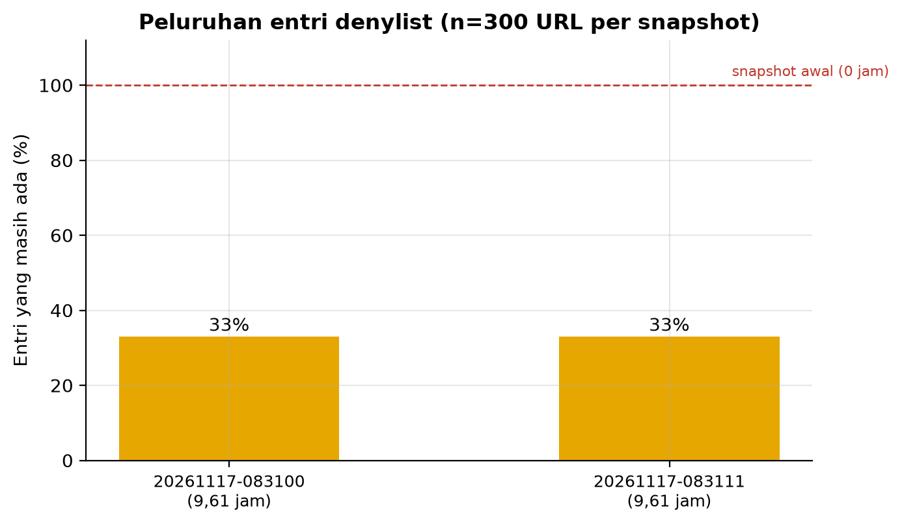
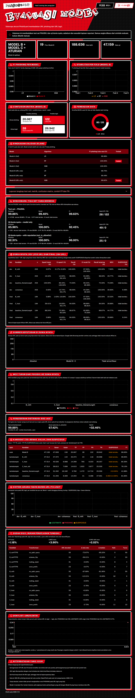

# Bab 4 — Implementasi dan Lingkungan

## 4A Lingkungan pengembangan

PhishGuard ditulis 100% Python. Semua perintah dijalankan melalui `uv run`,
tidak ada `python` atau `pip` global. Versi yang dipakai lebih baru dari
asumsi awal dokumen: Reflex 0.11, DuckDB 2.0, scikit-learn 1.9, XGBoost 3.2,
pandas 3.x. Persyaratan runtime adalah Python >= 3.11.

Dependensi utama (dari `pyproject.toml`):

| Kelompok | Paket |
|---|---|
| Produksi | duckdb, fastapi, httpx, joblib, kagglehub, pandas, pyarrow, python-dotenv, reflex, scikit-learn, uvicorn[standard], xgboost |
| Pengembangan | matplotlib, pytest |

Port yang dipakai: FastAPI di 8001, backend Reflex di 8000, frontend Reflex di
3000. Port 8000 milik Reflex, sehingga FastAPI wajib di 8001 (R6).

Perintah yang paling sering dipakai:

```powershell
uv run python scripts/inspect_data.py
uv run python scripts/convert_parquet.py
uv run python src/train.py
uv run python src/evaluate.py
uv run pytest -q
uv run uvicorn api.main:app --port 8001
$env:CI=1; uv run reflex run
uv run reflex compile
```

Variabel lingkungan opsional disimpan di `.env` (gitignored), dengan contoh di
`.env.example`: `PHISHGUARD_API_URL`, `PHISHGUARD_FEED_DIR`,
`PHISHGUARD_FEED_MAX_AGE_HOURS`, `PHISHGUARD_USE_GOOGLE`, dan
`PHISHGUARD_GOOGLE_API_KEY`. Nilai default menjaga sistem tetap offline.

## 4B Implementasi lapisan

### 4B.1 Lapisan 0: Google Safe Browsing (opsional)

Lapisan ini hanya aktif jika `PHISHGUARD_USE_GOOGLE=true` dan
`PHISHGUARD_GOOGLE_API_KEY` diisi. Ia mengirim URL yang diperiksa ke Google
Safe Browsing melalui HTTP dengan timeout 5 detik. jika cocok, vonis
`PHISHING` dengan source `google_safe_browsing`. jika tidak cocok atau API
gagal, sistem lanjut ke lapisan offline. Default `false` menjaga sistem
offline-first. Layer ini diuji terpisah di `tests/test_google_sb.py` dan
dievaluasi dengan mock label-aware sebagai skenario batas atas di
`docs/layer_tests.json`.

### 4B.2 Lapisan 1: denylist feed

`scripts/sync_feeds.py` adalah satu-satunya skrip yang membuka jaringan secara
rutin. Ia mengunduh snapshot feed OpenPhish ke `data/feeds/` dengan stempel
waktu UTC, tanpa menimpa snapshot lama. Feed dimuat oleh `src/denylist.py`
dengan batas umur (`FEED_MAX_AGE_HOURS`, default 24 jam). Feed yang basi atau
hilang dilewati, bukan dianggap gagal.


**Gambar 4.1** Flowchart `sync_feeds.py`. Sumber: `results/diagrams/sync_feeds.mmd`.



**Gambar 4.2** Hanya 33% dari 300 entri snapshot awal yang masih ada di dua
snapshot berikutnya setelah 9,61 jam. n = 300 URL per snapshot, 3 snapshot.
Sumber: `docs/denylist.json`.

Pada set uji dunia nyata, denylist sendirian hanya menandai 1 dari 300 URL
phishing (0,33%) dan 0 dari 55 URL legit. Feed berubah cepat (retensi 33%
dalam 9,61 jam), sehingga perannya adalah lapisan awal yang murah, bukan
detektor utama.

### 4B.3 Lapisan 2: allowlist

`src/reputation.py` memuat `src/trusted_domains.json` (~60 domain korporat)
sebagai singleton dengan fallback set kosong. Pencocokan bersifat exact setelah
normalisasi lowercase, penghapusan trailing dot, dan penghapusan awalan `www.`.
Tidak ada wildcard, user-content, maupun shortener di daftar. Domain yang cocok
langsung mendapat `LEGITIMATE` dengan `decision_source="allowlist"` dan
`probability=null`. Domain user-controlled seperti `*.vercel.app` dan
`*.github.io` sengaja tidak di-allowlist.

### 4B.4 Lapisan 3: model

Model B (`src/model.pkl`, XGBoost, 19 fitur) dan Model C
(`models/experimental/C_host.pkl`, host-only) dijalankan setelah allowlist
gagal. Model B memuat pipeline, lookup TLD, dan stats secara lazy singleton.
Model C bersifat opsional: jika artefaknya tidak ada, lapisan C dilewati.
Paritas fitur antara training dan serving diverifikasi pada 5.000 baris sampel
split latih; sebagian besar fitur memiliki exact match 100%, sedangkan
`NoOfLettersInURL`, `LetterRatioInURL`, `NoOfOtherSpecialCharsInURL`, dan
`SpacialCharRatioInURL` sengaja berbeda karena definisi dataset tidak dapat
direproduksi dari string (lihat 3B.2).

### 4B.5 Lapisan 4: shortener

`is_shortener(host)` memeriksa apakah host ada di daftar pemendek URL. jika ya
dan vonis sementara `LEGITIMATE`, vonis dinaikkan menjadi `SUSPICIOUS` risk
sedang dengan source `shortener`. Shortener tidak menurunkan `SUSPICIOUS`
tinggi. Pada set uji dunia nyata, tidak ada URL yang memicu lapisan ini
(rate 0,0 pada kedua kelas).

### 4B.6 API

FastAPI menyediakan `POST /check` dan `GET /health`. Endpoint `check` bersifat
sinkron (CPU-bound `predict_url` dijalankan threadpool). `ValueError` dan
`RequestValidationError` dipetakan menjadi HTTP 400 dengan `{"detail": ...}`.
CORS memakai allowlist eksplisit (`localhost:3000`, `127.0.0.1:3000`) dengan
`allow_credentials=False`, bukan `"*"`. `/health` mencoba `_load()` dan
melaporkan `model_loaded`.

### 4B.7 Antarmuka evaluasi

Halaman `/evaluasi` memuat artefak saat `on_load`, bukan saat compile. Gambar
berikut adalah placeholder karena tangkapan layar belum diambil.

- `

**Gambar 4.4** Halaman Evaluasi menampilkan metrik test set, tabel CV, dan panel
sumber keputusan.

## 4C Etika dan batasan

### 4C.1 Klausul offline

Default inference tidak mengakses jaringan dan tidak pernah membuka,
me-resolve, atau memprobe URL yang dianalisis. `extract_features()` murni
string ke dict. Pengecualian opt-in adalah Lapisan 0 Google Safe Browsing,
yang dikendalikan variabel lingkungan dan default mati. Hanya
`scripts/sync_feeds.py` yang boleh mengunduh daftar feed publik secara berkala,
dan data feed tidak didistribusikan ulang.

### 4C.2 Data dan lisensi

- `data/` (CSV, ZIP, Parquet), `*.duckdb`, `.venv/`, `.web/`, `__pycache__/`,
  `.env`, dan `kaggle.json` tidak pernah di-commit (NF3).
- PhiUSIIL berlisensi CC BY-NC-SA 4.0: tidak didistribusikan ulang.
- OpenPhish: Terms of Use mengizinkan riset akademik/personal tetapi melarang
  mendistribusikan ulang data mentah. Karena itu `data/realworld/` tidak
  di-commit dan `docs/realworld.json` hanya memuat agregat.
- URL phishing nyata tidak pernah dibuka, di-resolve, atau di-probe selama
  pelabelan dan inferensi.

### 4C.3 Risiko yang diakui

Risiko dari PRD yang relevan untuk implementasi ini:

| Risiko | Mitigasi yang diterapkan |
|---|---|
| R1 Arah label terbalik | `LABEL_LEGIT=1, LABEL_PHISH=0`; assertion di `tests/` |
| R2 Leakage fitur konten | Strategi dua model (A evaluasi, B produksi) |
| R6 Konflik port | FastAPI di 8001, Reflex di 8000 |
| R9 Link demo mati | String URL tetap bisa dianalisis meski situs mati |
| R11 Dataset kadaluarsa | Diakui di laporan; cadangan UCI Phishing Websites |

### 4C.4 Batasan yang tetap ada

- Tidak ada WHOIS atau umur domain; kategori `domain_tua` pada analisis FN
  ditandai MISSING.
- Lapisan peniruan merek (T20) belum diimplementasikan.
- PhishTank denylist, whois domain-age, dan threat intel ditunda (future work
  T17) agar tidak melanggar klausul no network at inference.
- Domain user-controlled tidak di-allowlist; andalkan model dan uncertainty band.
- Metrik test set adalah metrik model-only; lapisan reputasi tidak mengubah
  test set.
