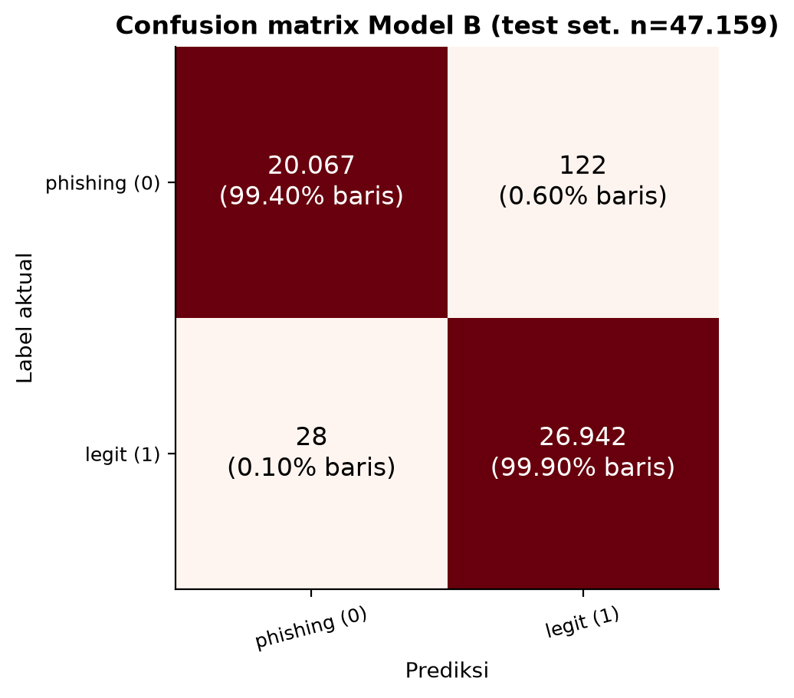
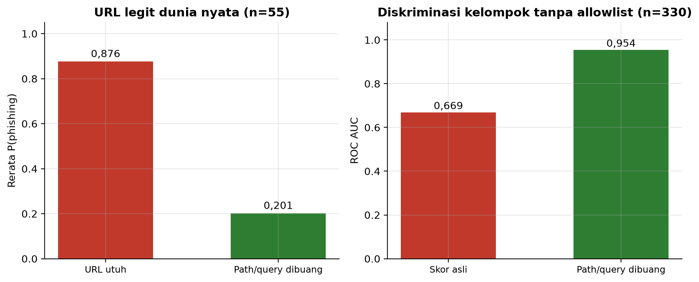
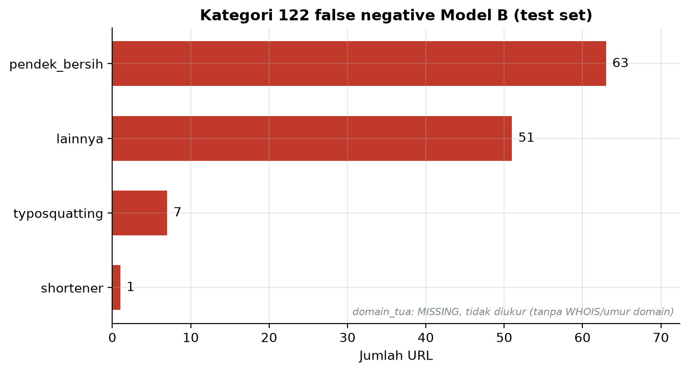
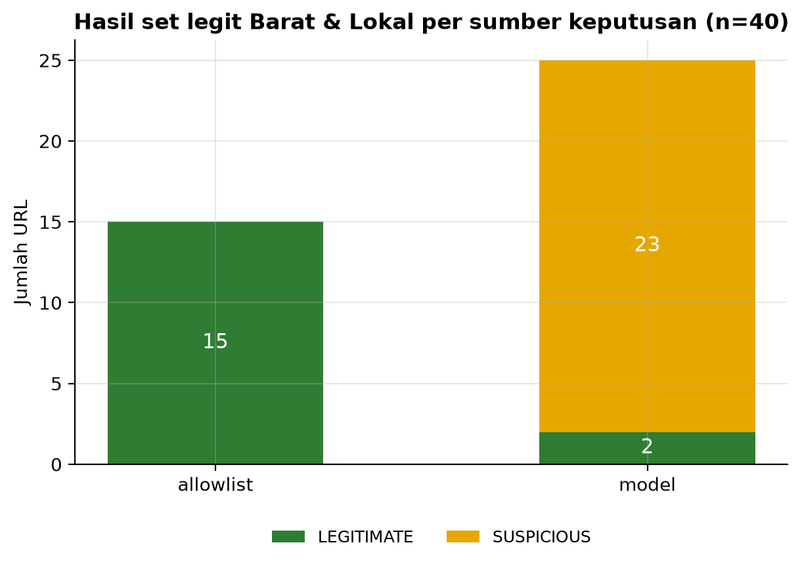
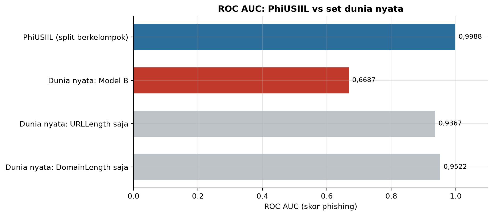
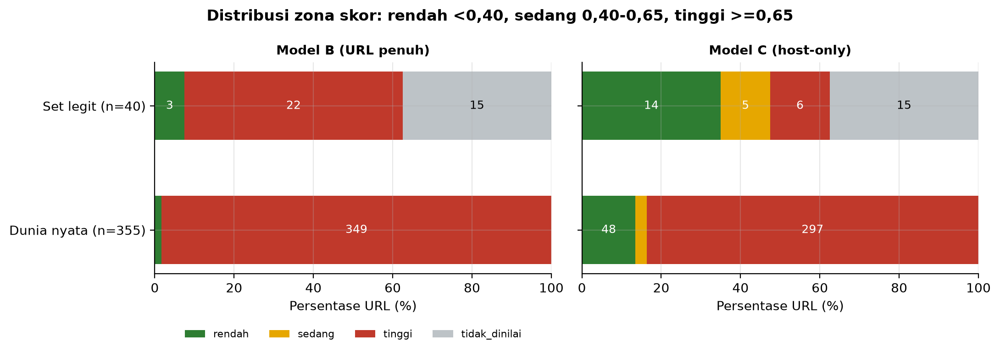
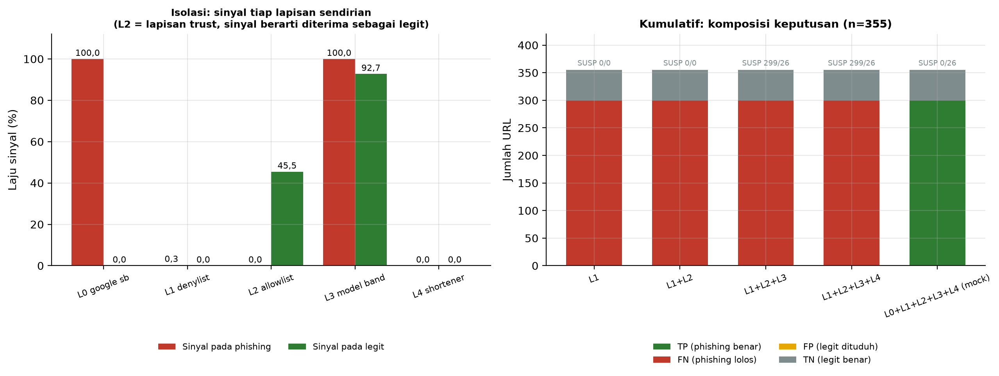

# Bab 5 — Evaluasi dan Analisis

## 5A Skenario pengujian

Pengujian dilakukan pada empat skenario yang disebut PRD:

1. Cek URL mencurigakan: URL dari feed OpenPhish (misalnya
   `http://megashorkxturtle.github.io/Netflix__clone`) menghasilkan `PHISHING`
   risk tinggi dengan source `denylist`.
2. Verifikasi situs legitim: `https://github.com` menghasilkan `LEGITIMATE` risk
   rendah dengan source `allowlist` dan probability kosong.
3. URL yang tidak ada di dataset: `https://example.com` menghasilkan
   `SUSPICIOUS` risk sedang karena Model B dan Model C berbeda zona.
4. Batas kemampuan: URL phishing pendek dan bersih lolos sebagai false negative,
   didokumentasikan di 5D.

Empat himpunan data yang dipakai:

| Himpunan | n | Sumber | Peran |
|---|---|---|---|
| Test set PhiUSIIL | 47.159 | Split stratified 80/20 seed 42 | Metrik model (5B, 5C) |
| Set dunia nyata | 355 | 300 OpenPhish + 55 legit manual | Validasi live (5D, 5E) |
| Set legit Barat & Lokal | 40 | 20 Barat + 20 lokal | Validasi UX (5D) |
| Feed OpenPhish | 300 per snapshot | Snapshot lokal | Lapisan denylist (4B.2) |

## 5B Evaluasi test set

Tabel 5.1 merangkum metrik pada test set (phishing sebagai kelas positif,
`pos_label=0`).

| Model | Fitur | Accuracy | Precision | Recall | F1 | FP | FN |
|---|---|---|---|---|---|---|---|
| B (XGBoost) | 19 | 0,9968 | 0,9986 | 0,9940 | 0,9963 | 28 | 122 |
| A (Random Forest) | 50 | 1,0000 | 1,0000 | 1,0000 | 1,0000 | 0 | 0 |

Sumber: `docs/hasil_evaluasi.md`.

**Gambar 5.1** Model B salah menilai 150 dari 47.159 URL uji, terdiri atas
122 false negative dan 28 false positive (0,32%). n = 47.159 URL test set.
Sumber: `docs/hasil_evaluasi.md`.

Confusion matrix Model B: TP 20.067, FN 122, FP 28, TN 26.942. Model A
mencapai TP 20.189 dan TN 26.970 tanpa kesalahan, tetapi itu karena fitur
konten halaman (`URLSimilarityIndex`, `NoOfExternalRef`, `LineOfCode`) yang
tidak tersedia saat inference live. Ini adalah leakage yang didokumentasikan,
bukan disembunyikan (R2).

Tabel 5.2 merangkum 5-fold CV pada data latih (F1 phishing).

| Model | Algoritma | CV F1 phishing (rata-rata) | Terpilih |
|---|---|---|---|
| A | Logistic Regression | 0,999845 | |
| A | Random Forest | 1,000000 | ya |
| A | XGBoost | 0,999975 | |
| B | Logistic Regression | 0,987021 | |
| B | Random Forest | 0,994944 | |
| B | XGBoost | 0,996208 | ya |

Sumber: `docs/metrics.json`.

Model C pada split berkelompok per host (dedup 235.370 baris, 220.077 host)
mencapai F1 0,7915 dan AUC 0,8817, sedangkan Model B refit mencapai F1
0,9965 dan AUC 0,9988 pada split yang sama. Perbedaan protokol ini (split
berkelompok per host, bukan acak 80/20) harus disebut saat membandingkan
dengan AUC PhiUSIIL 0,9988.

## 5C Analisis false positive

28 false positive Model B adalah URL legit yang diprediksi phishing. Pola yang
terlihat: URL legit pendek, HTTPS, tanpa digit/simbol, sering domain bank atau
populer dengan path `/login`. Skor berada di 0,70–0,99, sehingga uncertainty
band (0,40–0,65) tidak menyelamatkannya. Yang memperbaiki false positive dunia
nyata adalah lapisan allowlist, misalnya `github.com`.

Pada set dunia nyata, 25 dari 30 URL legit yang tidak ada di allowlist
diprediksi phishing oleh model (specificity 0,1667). Fitur yang paling
mendorong ke arah phishing pada 25 kasus itu adalah `DomainLength` (kontribusi
rata-rata 9,39), `URLLength` (5,48), dan `NoOfOtherSpecialCharsInURL` (2,66).
IsHTTPS justru menurunkan skor (-1,09), tetapi tidak cukup menyeimbangkan.

**Gambar 5.2** Membuang path dan query menurunkan rerata skor URL legit dari
0,876 ke 0,201 dan menaikkan ROC AUC dari 0,669 ke 0,954. n = 55 URL legit;
330 URL kelompok tanpa allowlist. Sumber: `docs/realworld.json`.

Temuan penting dari ablation ini adalah model bergantung kuat pada path dan
query string. URL legit dengan path panjang (repo, dokumentasi, berita) terbaca
sebagai phishing karena panjang dan jumlah karakter khusus. Ketika path dan
query dibuang, AUC naik dari 0,669 ke 0,954. Ini menjelaskan mengapa
`DomainLength` dan `URLLength` mendominasi kontribusi pada false positive.
Mitigasi yang diterapkan adalah allowlist untuk domain tepercaya dan
uncertainty band untuk URL yang tidak pasti.

## 5D False negative dan validasi dunia nyata

### 5D.1 Kategori false negative

122 false negative Model B adalah URL phishing yang diprediksi legit. Pola:
URL phishing pendek dan bersih (`https://...`, tanpa query, sedikit simbol),
mirip URL legit di dataset. Ini konsisten dengan dominasi `IsHTTPS` (0,749)
dan keterbatasan fitur leksikal murni.

**Gambar 5.3** 63 dari 122 false negative adalah URL pendek dan bersih, hanya
1 shortener dan 7 kandidat typosquatting. n = 122 FN test set. Sumber:
`results/data/fn_categories.json`.

Rincian kategori (heuristik string, bukan lapisan keputusan baru):

| Kategori | n | Catatan |
|---|---|---|
| URL pendek dan bersih (panjang <= 30, ASCII, tanpa `? @ %`) | 63 | |
| Lainnya | 51 | |
| Typosquatting/peniruan merek (string) | 7 | netflix, amazon, goto, microsoft, apple |
| Shortener | 1 | `tinyurl.com` |

Kategori phishing pada domain tua tidak dapat dikategorisasi tanpa data umur domain
(whois/RDAP) yang memang di-defer sebagai future work; karenanya tidak termasuk
dalam taksonomi ini.

Sumber: `results/data/fn_categories.json`.

### 5D.2 Validasi pada set legit Barat dan Lokal

Set ini berisi 40 URL (20 Barat, 20 lokal), dievaluasi offline dengan
`PHISHGUARD_USE_GOOGLE=false` dan batas umur feed 168 jam. Hasilnya: 17
`LEGITIMATE` dan 23 `SUSPICIOUS`, tanpa `PHISHING`. Dari 17 `LEGITIMATE`,
15 berasal dari allowlist dan 2 dari model (`debian.org`, `ojk.go.id`). Dari
25 URL yang dinilai model, 23 berakhir `SUSPICIOUS`.

**Gambar 5.4** 23 dari 25 URL legit yang dinilai model berakhir
`SUSPICIOUS`, sedangkan 15 dari 17 `LEGITIMATE` berasal dari allowlist.
n = 40 URL (20 Barat, 20 lokal). Sumber:
`results/data/legit_barat_lokal_results.json`.

Dua temuan menarik:

- URL dengan parameter UTM (`tokopedia.com/search?...`) diskor 1,0000 (risk
  sedang) karena Model B tinggi dan Model C rendah. Sebaliknya, URL Kompas
  dengan UTM serupa tetap `LEGITIMATE` karena domain `kompas.com` ada di
  allowlist.
- URL panjang dengan path dokumentasi (Wikipedia, MDN, Python docs, PyPI, npm,
  Docker Hub, Kubernetes, arXiv) konsisten berakhir `SUSPICIOUS` risk sedang,
  sesuai pola di 5C.

### 5D.3 Validasi dunia nyata dan ROC AUC

Set dunia nyata berisi 355 URL: 300 phishing dari snapshot OpenPhish dan 55
legit hasil kurasi manual, dikumpulkan 2026-11-16. Pada kelompok 330 URL yang
tidak ada di allowlist (300 phishing, 30 legit), Model B mencapai recall 1,0
tetapi specificity hanya 0,1667, dengan ROC AUC 0,6687.

**Gambar 5.5** ROC AUC Model B turun dari 0,9988 pada PhiUSIIL (split
berkelompok) ke 0,6687 pada data dunia nyata, lebih rendah daripada baseline
satu fitur `DomainLength` (0,9522). n = 330 URL tanpa allowlist (300
phishing, 30 legit). Sumber: `docs/model_c.json`, `docs/realworld.json`.

Ini adalah temuan utama laporan: performa test set tinggi karena distribusi
dataset, sedangkan pada data dunia nyata model bergantung pada panjang URL
dan jumlah karakter khusus. Baseline satu fitur `DomainLength` (AUC 0,9522)
dan `URLLength` (AUC 0,9367) mengalahkan model (0,6687). Setelah path dan
query dibuang, AUC naik ke 0,9541 (lihat 5C). Model C (host-only) mencapai
AUC 0,9173 dan specificity 0,7333 pada kelompok yang sama, tetapi recall
turun ke 0,95.

**Gambar 5.6** Zona 0,40–0,65 hampir kosong di data dunia nyata (0 dari 355
pada Model B, 10 dari 355 pada Model C), tetapi menampung 5 dari 40 URL set
legit pada Model C. n = 355 URL dunia nyata; 40 URL set legit. Sumber:
`results/data/band_distribution.json`.

Pada set dunia nyata, Model B menempatkan 349 dari 355 URL di zona tinggi dan
6 di zona rendah; zona sedang kosong. Model C menempatkan 297 tinggi, 10
sedang, 48 rendah. Pada set legit, Model B menempatkan 22 tinggi, 0 sedang,
3 rendah, dan 15 tidak dinilai (allowlist); Model C menempatkan 6 tinggi,
5 sedang, 14 rendah, 15 tidak dinilai.

## 5E Efektivitas berlapis

### 5E.1 Isolasi dan kumulatif

Tabel 5.3 merangkum isolasi tiap lapisan (masing-masing sendirian) pada set
dunia nyata.

| Lapisan | Jenis | Phishing ditandai | Legit ditandai |
|---|---|---|---|
| L0 Google SB (mock) | deny | 300/300 (1,0000) | 0/55 (0,0000) |
| L1 Denylist | deny | 1/300 (0,0033) | 0/55 (0,0000) |
| L2 Allowlist | trust | 0/300 (0,0000) | 25/55 (0,4545) |
| L3 Model B+C | deny | 300/300 (1,0000) | 51/55 (0,9273) |
| L4 Shortener | deny | 0/300 (0,0000) | 0/55 (0,0000) |

Sumber: `docs/layer_tests.json` (isolation).

Tabel 5.4 merangkum kumulatif (lapisan ditambahkan satu per satu).

| Tahap | Recall phishing | Specificity | F1 | SUSPICIOUS (phish/legit) |
|---|---|---|---|---|
| L1 saja | 0,0033 | 1,0000 | 0,0066 | 0/0 |
| L1+L2 | 0,0033 | 1,0000 | 0,0066 | 0/0 |
| L1+L2+L3 | 0,0033 | 1,0000 | 0,0066 | 299/26 |
| L1+L2+L3+L4 | 0,0033 | 1,0000 | 0,0066 | 299/26 |
| L0+L1+...+L4 (mock) | 1,0000 | 1,0000 | 1,0000 | 0/26 |

Sumber: `docs/layer_tests.json` (cumulative). Catatan: pada tahap L1+L2+L3,
semua URL yang tidak tertangkap denylist/allowlist diberi `SUSPICIOUS` oleh
model (karena kedua model tinggi pada phishing dan 51/55 legit), sehingga
recall biner tetap 0,0033 (SUSPICIOUS dihitung non-phishing). L0 mock menaikkan
recall kumulatif ke 1,0.

**Gambar 5.7** Denylist sendirian hanya menandai 0,3% phishing, sedangkan
Model B+C sendirian menandai 100% phishing dan 92,7% legit sebagai
`SUSPICIOUS`; penambahan L0 (mock) menaikkan recall kumulatif ke 1,0.
n = 355 URL (300 phishing, 55 legit). Sumber: `docs/layer_tests.json`.

### 5E.2 Peran band 0,40–0,65

Zona sedang (0,40–0,65) adalah mekanisme transparansi keputusan, bukan
detektor. Pada data dunia nyata zona ini hampir kosong pada Model B (0 dari
355) dan kecil pada Model C (10 dari 355), karena kedua model cenderung
menghasilkan skor ekstrem. Namun pada set legit zona ini menampung 5 dari 40
URL pada Model C, dan pada Model B zona ini menampung 0. Artinya, ketika model
tidak yakin, sistem menandai `SUSPICIOUS` alih-alih `PHISHING`, sehingga
pengguna mendapat sinyal "perlu verifikasi manual" dan false positive langsung
tidak terjadi. Band ini tidak mengubah `label` biner 0/1 (tetap threshold 0,5)
agar metrik tetap kompatibel.

### 5E.3 Batasan efektivitas

- L0 dievaluasi dengan mock label-aware (source == openphish) sebagai skenario
  batas atas, bukan akurasi Google Safe Browsing.
- Lapisan peniruan merek (T20) belum diimplementasikan, sehingga tidak ada
  baris ujinya. 7 kandidat typosquatting pada 5D.1 belum tertangkap lapisan.
- Guard anti-melingkar membatalkan run bila snapshot feed memuat set uji;
  overlap yang diizinkan maksimal 5%.
- Feed berubah cepat (retensi 33% dalam 9,61 jam), sehingga lapisan denylist
  perlu refresh berkala.
- Model C bersifat opsional dan artefaknya gitignored; bila tidak ada, lapisan
  C dilewati.
