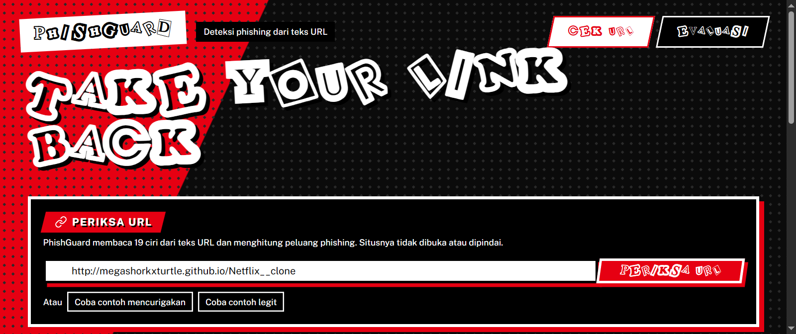

# Checklist tangkapan layar (T31.5)

Tangkapan layar diambil **manual oleh pemilik** dan disimpan di folder ini. Agen tidak
membuat gambar. Jalankan UI lebih dulu:

```powershell
$env:CI=1; uv run reflex run
```

Buka `http://localhost:3000`. Ukuran jendela yang disarankan 1440x900; untuk halaman
evaluasi gunakan tangkapan penuh (full page). Jangan menampilkan `.env`, API key, atau
data pribadi di layar.

| No | Halaman | Kasus | URL | Yang harus terlihat | Nama berkas |
|---|---|---|---|---|---|
| 1 | Cek URL (`/`) | Phishing dari denylist | URL dari `results/data/api_examples/01_phishing_denylist.json` | Kartu vonis `PHISHING`, risk `tinggi`, sumber `denylist`, trail lapisan denylist `cocok` | `01_cek_phishing.png` |
| 2 | Cek URL (`/`) | Legit dari allowlist | `https://github.com` | Kartu vonis `LEGITIMATE`, risk `rendah`, sumber `allowlist`, trail allowlist `cocok`, probability kosong | `02_cek_legit.png` |
| 3 | Cek URL (`/`) | Tidak terverifikasi | `https://example.com` | Kartu vonis `SUSPICIOUS`/TIDAK TERVERIFIKASI, risk `sedang`, sumber `model`, trail `model_b` dan `model_c` dengan zona berbeda | `03_cek_suspicious.png` |
| 4 | Evaluasi (`/evaluasi`) | Ringkasan artefak | - | Metrik test set, tabel CV, dan panel sumber keputusan | `04_evaluasi.png` |

Catatan:

- Untuk kasus 1, samakan URL dengan respons API yang tersimpan. Bila snapshot feed sudah
  berganti, pilih URL lain yang masih ada di snapshot dan catat di keterangan gambar.
- Untuk kasus 3, `example.com` sengaja dipakai sebagai URL netral yang tidak ada di
  allowlist/denylist. Vonis `SUSPICIOUS` di sini adalah hasil band, bukan label phishing.
- Setelah semua gambar ada, perbarui `results/laporan/data_status.md` dari MISSING
  menjadi OK untuk butir screenshot.

## Arahan penyisipan ke laporan (markdown)

Sisipkan gambar dari `results/laporan/bab3.md` atau `bab4.md` dengan path relatif dan
kapsi di bawahnya. Contoh untuk halaman cek URL:

```markdown


**Gambar 3.5** Halaman Cek URL menampilkan vonis `PHISHING` dengan sumber keputusan
`denylist` dan trail lapisan yang dapat dibaca pengguna.
```

Aturan penulisan:

- Alt text mendeskripsikan isi gambar, bukan nama berkas.
- Kapsi wajib memuat nomor gambar, vonis yang terlihat, dan sumber keputusan
  (`denylist`, `allowlist`, atau `model`) supaya klaim di bab bisa dilacak.
- Jangan menyalin angka dari layar ke prosa. Angka tetap merujuk
  `results/data/api_examples/*.json` atau `docs/metrics.json`.
- Gunakan path relatif `../screenshots/...` karena laporan berada di `results/laporan/`.
- Selama berkas gambar belum ada, tulis placeholder
  `<TODO: screenshot 01_cek_phishing.png, lihat results/screenshots/CHECKLIST.md>`
  dan jangan mengarang deskripsi tampilan.

Daftar sisipan yang sudah disiapkan untuk Bab 3 (subbagian 3D, antarmuka):

| Gambar | Berkas | Dipakai di |
|---|---|---|
| Gambar 3.5 | `01_cek_phishing.png` | 3D, contoh keputusan lapisan denylist |
| Gambar 3.6 | `02_cek_legit.png` | 3D, contoh keputusan lapisan allowlist |
| Gambar 3.7 | `03_cek_suspicious.png` | 3D, contoh zona tidak terverifikasi |
| Gambar 4.4 | `04_evaluasi.png` | 4B, halaman evaluasi artefak |

